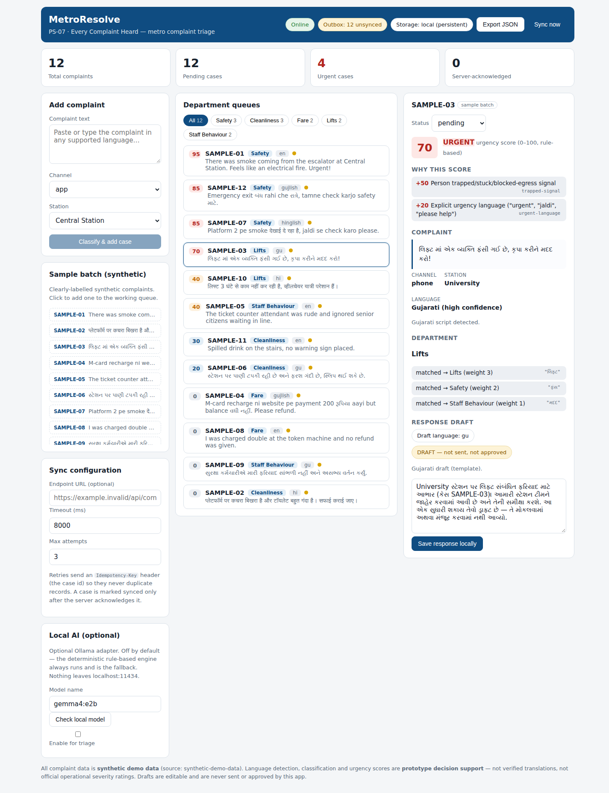
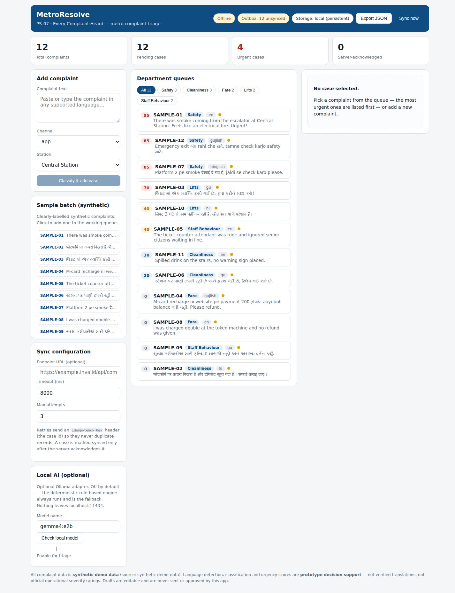

<div align="center">

# MetroResolve

**Every Complaint Heard — Metro Operations (PS-07)**

Offline-first complaint triage for a station controller.
Complaints arrive in Gujarati, Hindi, English, and mixed
Gujlish/Hinglish — MetroResolve classifies each one into a
department queue, scores urgency with visible reasons, and
drafts an editable reply in the complainant's language.
Fully on-device. Fully offline after first load.


</div>

<br>


## Highlights

- **Operations dashboard** — total, pending, urgent, and
  server-acknowledged complaint counts.
- **Multilingual triage** — 12 labelled synthetic samples in
  English, Hindi, Gujarati, Gujlish, and Hinglish; script +
  lexicon detection with an honest confidence note.
- **Five department queues** — Safety, Cleanliness, Fare,
  Lifts, Staff Behaviour — with matched keywords shown per
  case, so every classification is explainable.
- **Urgency scoring with reasons** — 0–100, nine configurable
  rules (trapped person +50, fire +50, harm +40, …), every
  fired rule listed as a visible reason.
- **Reply drafts in the detected language** — Gujarati /
  Hindi / English templates; always labelled
  *DRAFT — not sent, not approved*.
- **Offline-first PWA** — service-worker shell cache; after
  one online load the entire workflow runs with zero network.
- **Honest sync** — configurable HTTP endpoint, idempotency
  keys, backoff retries; "synced" appears only after a real
  2xx server acknowledgement. Until then: local outbox +
  JSON export.
- **Optional local Ollama adapter** — off by default,
  localhost-only, never blocks the rule-based engine.

## Quickstart

```bash
npm install
npm run dev        # http://localhost:5173  (dev, hot reload)
npm run build      # TypeScript check + production build → dist/
npm run preview    # http://localhost:4173  (production build)
```

No runtime dependencies beyond the React toolchain. No
backend, no hosted database, no external APIs, no CDN
fonts or assets.

## Demo walkthrough (≈3 minutes)

1. **Dashboard** — 12 complaints, 12 pending, 4 urgent,
   outbox "12 unsynced".
2. **Open SAMPLE-03** — Gujarati lift complaint → Lifts,
   urgency **70 URGENT**, reasons *person trapped* +
   *urgent language*, Gujarati draft labelled
   *DRAFT — not sent, not approved*.
3. **Add a manual complaint** — paste Gujarati, Hindi, or
   Gujlish text → MR-0001 classified into a department
   queue with its own reasons.
4. **Edit the draft → Save response locally** — case
   marked unsynced, outbox count increments.
5. **Hard-reload** — every case and edit persists.
6. **DevTools → Network → Offline → hard-reload** — the
   full app still works; the header shows **Offline**.
7. **Export JSON** — downloads every case.



## Offline verification

```bash
npm run build && npm run preview
# 1. Open http://localhost:4173 once while online
#    (the service worker caches the app shell).
# 2. DevTools → Application → Service Workers: worker active;
#    Application → Cache Storage: metroresolve-shell-v1 present.
# 3. DevTools → Network → Offline → hard-reload.
# 4. Dashboard, triage, editing, local save, and export all work.
```



## Architecture

```
src/App.tsx               dashboard, queues, detail panel, sync UI
src/main.tsx              mount + production-only SW registration
src/lib/nlp.ts            language detection, classifier, urgency
                          rules, reply templates
src/lib/cases.ts          CaseRecord model, factory, id sequence
src/lib/storage.ts        safe localStorage wrapper (JSON + fallback)
src/lib/sync.ts           HTTP sync adapter (idempotent, retrying)
src/lib/ollama.ts         optional local Ollama inference adapter
src/data/complaints.json  12 synthetic complaints + stations/channels
public/sw.js              shell cache service worker
docs/                     requirements, design, tasks, validation,
                          decisions, final report, submission pack
```

Bundled JSON is imported at build time — zero network
requests to render the shell or load data. localStorage is
the single source of truth for case state; sync is an
overlay on each `CaseRecord`, never a second store.

### Sync semantics

| Server response | Behaviour |
|---|---|
| 2xx | `synced` + `acknowledgedAt` — the only path that ever claims synced |
| 4xx (except 429) | permanent `failed` after 1 attempt — retrying cannot fix it |
| network error / 429 / 5xx | retry with backoff up to `maxAttempts`, then `failed`; record retained |

Every POST carries `Idempotency-Key: <case.id>` so a retry
can never duplicate a record — a real endpoint must honour
the header. No endpoint is configured out of the box.

## Data & honesty labels

- All bundled complaint data is **synthetic demo data** —
  no real passenger complaints, no live service status.
- Language detection is a heuristic; fully romanized
  Gujlish/Hinglish is indistinguishable from English, and
  the app says so per-case.
- Urgency scores are **prototype decision support**, not
  official operational severity ratings.
- Drafts are templates — editable, never sent, never
  approved by this app.
- First load must be online once so the service worker can
  cache the shell; every later load works offline.

## Validation (production build)

Verified by a 33-check automated CDP harness plus targeted
diagnostics — full procedures in
[docs/validation.md](docs/validation.md):

- seed → 12 cases, stats 12/12/4/0 · 12/12 sample
  classifications across all four language groups
- manual entry (Gujarati → MR-0001, Lifts, 60) · response
  editing · reload persistence
- offline render from SW cache with Offline indicator
- sync paths: 404 → fail after 1 attempt · refused →
  2 attempts then fail, records retained · 2xx → all synced
  with idempotency keys on every request
- Ollama check: daemon detected, `gemma4:e2b` correctly
  reported not installed · JSON export · zero console errors

## Docs

| Document | Contents |
|---|---|
| [requirements.md](docs/requirements.md) | problem, user, scope, acceptance criteria |
| [design.md](docs/design.md) | architecture, data model, triage flow |
| [tasks.md](docs/tasks.md) | P0 (done) / P1 / P2 task list |
| [validation.md](docs/validation.md) | automated + manual test procedures |
| [decisions.md](docs/decisions.md) | architectural decisions and reasons |
| [final-report.md](docs/final-report.md) | tested / untested / known limitations |
| [submission.md](docs/submission.md) | Metro Hacks submission pack + record |

## Metro Hacks submission

Submitted 2026-10-10 for **PS-07 — Every Complaint Heard**
(Metro Operations track), DevFest Gandhinagar. The form
response was recorded after all fields were verified in the
live DOM. See [docs/submission.md](docs/submission.md) for
the exact answers as submitted.

---

<sub>Built for Metro Hacks on board the Gujarat Metro.
All demo data is synthetic; urgency scores and drafts are
decision support, not official ratings or sent messages.</sub>
